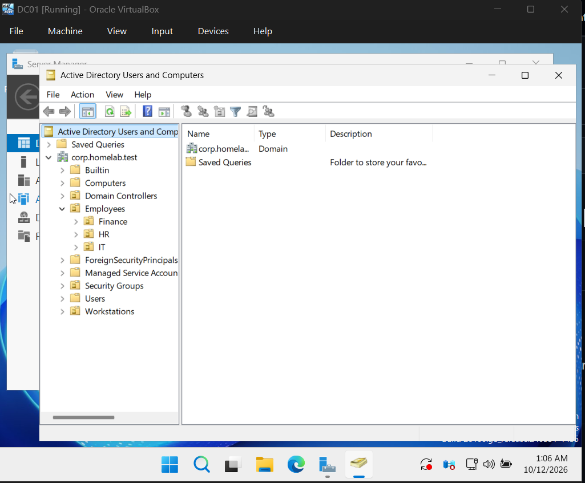
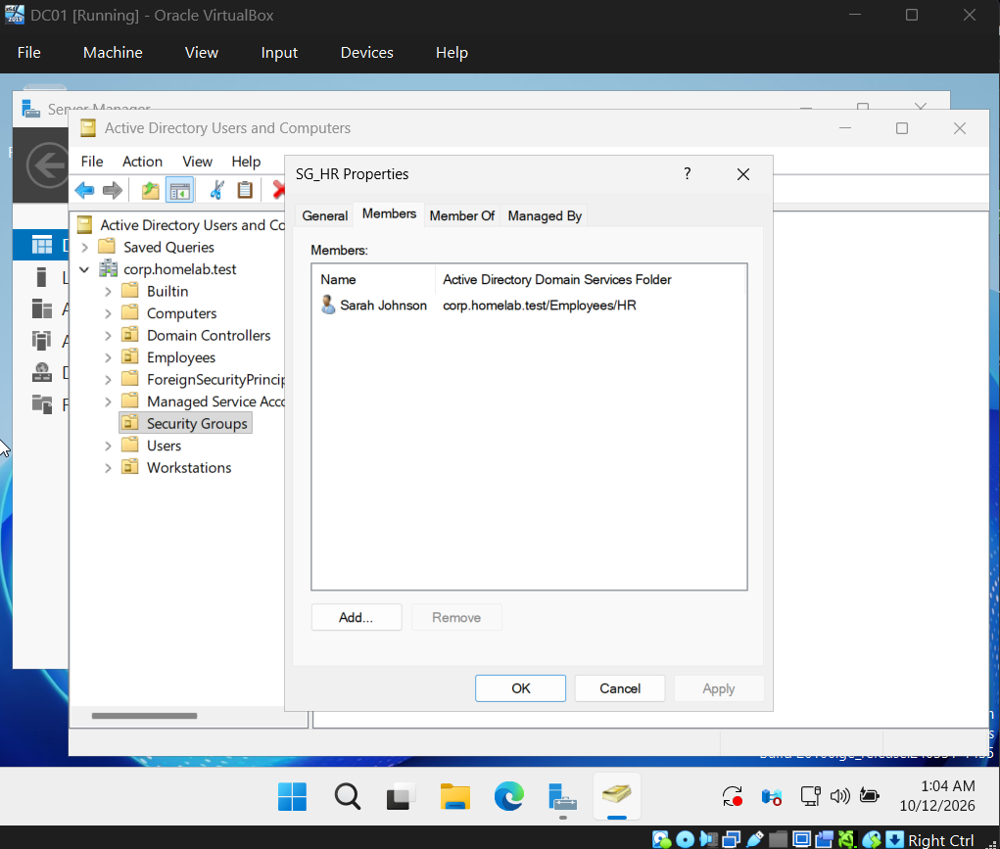
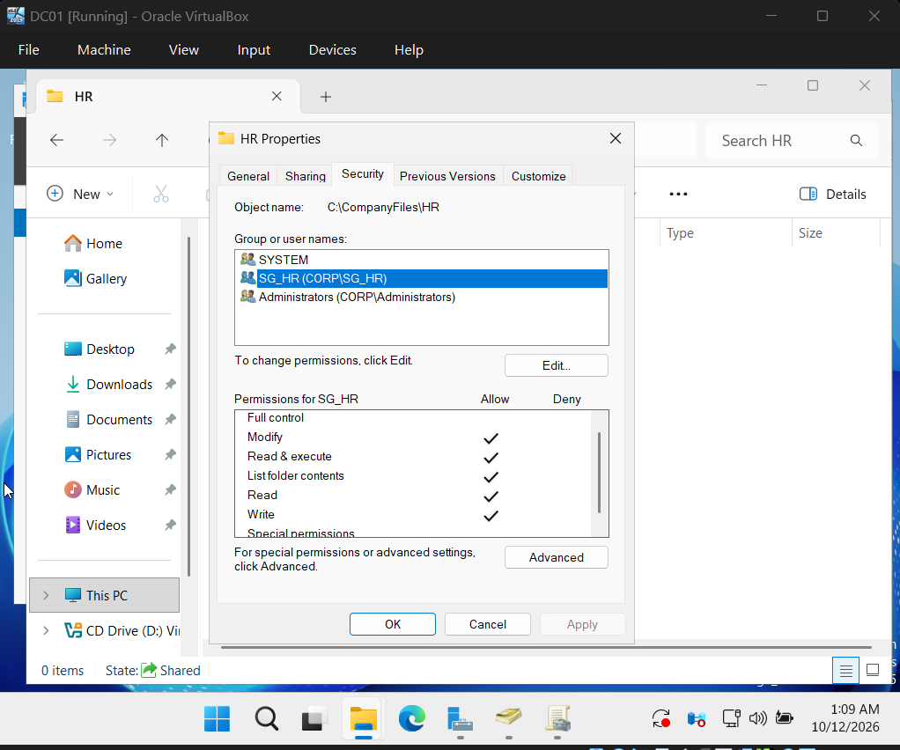

# Active Directory & Microsoft Entra ID IAM Homelab

## Project Overview

Built a hands-on Identity and Access Management (IAM) homelab to simulate enterprise identity administration, access control, account security, and auditing.

The project consists of two environments:

- **On-premises Active Directory:** Windows Server 2025 domain controller, Windows 11 domain-joined workstation, departmental security groups, Group Policy, and file permissions.
- **Microsoft Entra ID:** Cloud-based user administration, security group management, password resets, account disablement, and audit logging.

**Current status:** Both environments are configured independently. Hybrid identity synchronization is planned as a future enhancement.

## Technologies Used

- Windows Server 2025
- Active Directory Domain Services (AD DS)
- Microsoft Entra ID
- Windows 11 Pro
- PowerShell
- Group Policy Management
- Oracle VirtualBox
- NTFS Permissions

## Lab Architecture

### On-Premises Active Directory

| Component | Configuration |
|---|---|
| Domain Controller | DC01 — Windows Server 2025 |
| Active Directory Domain | corp.homelab.test |
| Client Workstation | CLIENT01 — Windows 11 Pro |
| Domain Controller IP | 192.168.100.10 |
| Workstation IP | 192.168.100.20 |
| Organizational Units | Employees, IT, HR, Finance, Workstations |
| Security Groups | SG_IT, SG_HR, SG_Finance |
| Virtualization | Oracle VirtualBox |

DC01 provides Active Directory Domain Services and DNS. CLIENT01 is joined to the domain and used to test authentication, group-based authorization, and workstation policies.

### Microsoft Entra ID

A separate Microsoft Entra ID tenant was configured to practice cloud identity administration.

The environment includes a cloud-only test user and an IT security group for testing account lifecycle operations and access management.

## 1. Active Directory User and OU Administration

Created an Active Directory domain and organized employee accounts into departmental organizational units.

Implemented the following structure:

- Employees
  - IT
  - HR
  - Finance
- Workstations
- Security Groups

Created test employee accounts and assigned them to their respective departments.

### Active Directory OU Structure

## 2. Security Group Management

Created departmental security groups to manage access through group membership rather than assigning permissions individually.

Configured the following groups:

- SG_IT — IT department
- SG_HR — Human Resources department
- SG_Finance — Finance department

Assigned users to the appropriate groups and verified membership using Active Directory Users and Computers.

### Security Group Membership

## 3. Role-Based Access Control and File Permissions

Created departmental folders under `C:\CompanyFiles` and configured NTFS permissions to restrict access based on Active Directory security group membership.

Configured a shared resource accessible through:

`\\DC01\CompanyFiles`

Tested access using a domain-joined Windows 11 workstation.

### Access Control Testing

1. Signed in using a departmental employee account.
2. Verified access to the authorized departmental folder.
3. Removed the employee from the relevant security group.
4. Signed out and back in to refresh group membership.
5. Verified that access was revoked.
6. Restored group membership and confirmed access was restored.

This demonstrated how group-based permissions support access provisioning and revocation.

### Departmental Folder Permissions

## 4. Group Policy and
