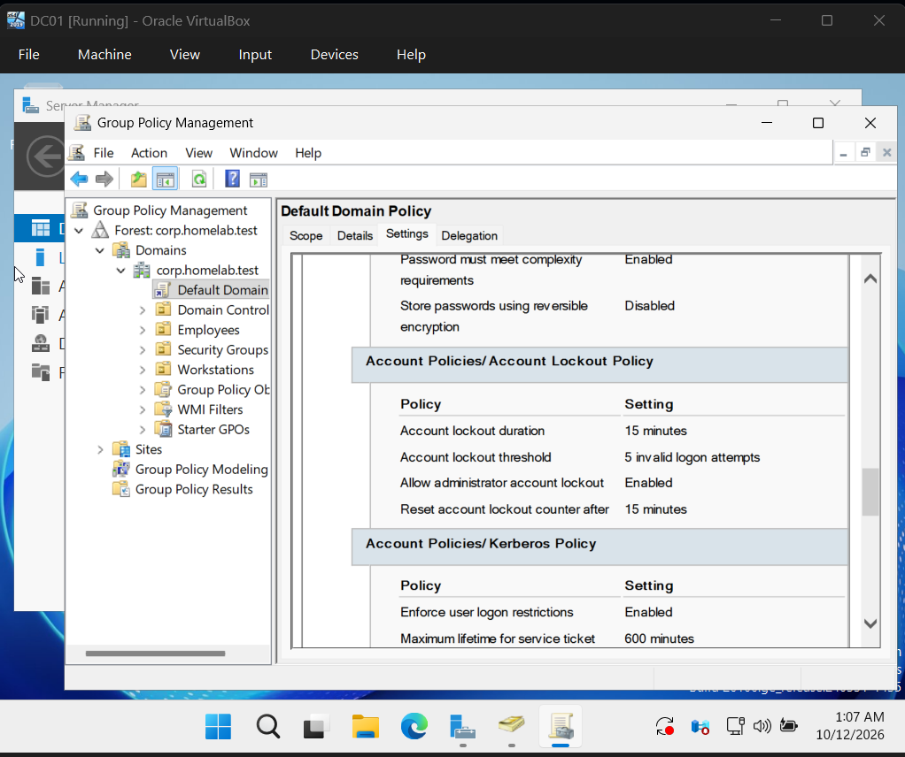
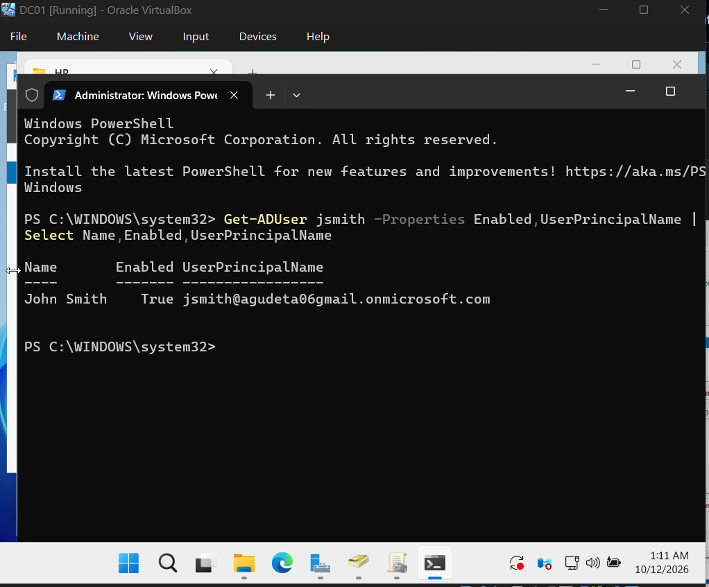
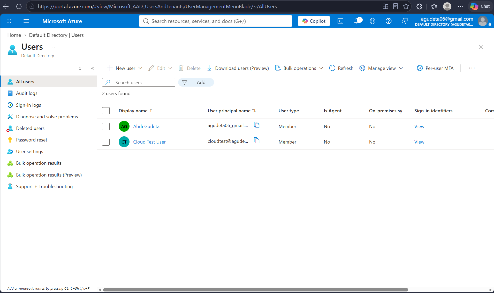
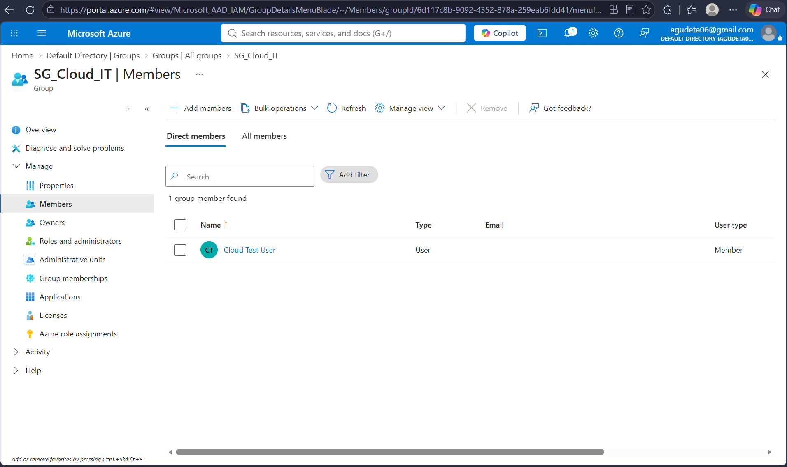
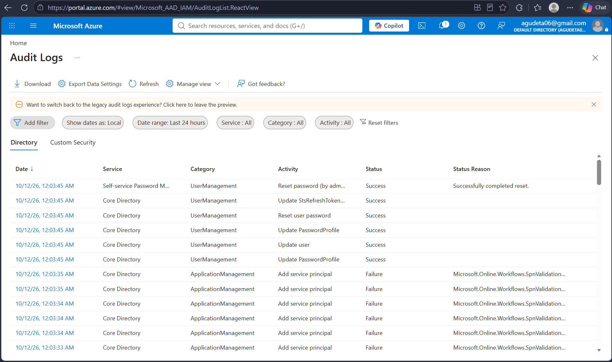

# Active Directory & Microsoft Entra ID IAM Homelab

## Project Overview

Built a hands-on Identity and Access Management (IAM) homelab to simulate enterprise identity administration, access control, account security, and auditing.

The project consists of two environments:

- **On-premises Active Directory:** Windows Server 2025 domain controller, Windows 11 domain-joined workstation, departmental security groups, Group Policy, and file permissions.
- **Microsoft Entra ID:** Cloud-based user administration, security group management, password resets, account disablement, and audit logging.

**Current status:** Both environments are configured independently. Hybrid identity synchronization is planned as a future enhancement.

## Technologies Used

- Windows Server 2025
- Active Directory Domain Services (AD DS)
- Microsoft Entra ID
- Windows 11 Pro
- PowerShell
- Group Policy Management
- Oracle VirtualBox
- NTFS Permissions

## Lab Architecture

### On-Premises Active Directory

| Component | Configuration |
|---|---|
| Domain Controller | DC01 — Windows Server 2025 |
| Active Directory Domain | corp.homelab.test |
| Client Workstation | CLIENT01 — Windows 11 Pro |
| Domain Controller IP | 192.168.100.10 |
| Workstation IP | 192.168.100.20 |
| Organizational Units | Employees, IT, HR, Finance, Workstations |
| Security Groups | SG_IT, SG_HR, SG_Finance |
| Virtualization | Oracle VirtualBox |

DC01 provides Active Directory Domain Services and DNS. CLIENT01 is joined to the domain and used to test authentication, group-based authorization, and workstation policies.

### Microsoft Entra ID

A separate Microsoft Entra ID tenant was configured to practice cloud identity administration.

The environment includes a cloud-only test user and an IT security group for testing account lifecycle operations and access management.

## 1. Active Directory User and OU Administration

Created an Active Directory domain and organized employee accounts into departmental organizational units.

Implemented the following structure:

- Employees
  - IT
  - HR
  - Finance
- Workstations
- Security Groups

Created test employee accounts and assigned them to their respective departments.

### Active Directory OU Structure


## 2. Security Group Management

Created departmental security groups to manage access through group membership rather than assigning permissions individually.

Configured the following groups:

- SG_IT — IT department
- SG_HR — Human Resources department
- SG_Finance — Finance department

Assigned users to the appropriate groups and verified membership using Active Directory Users and Computers.

### Security Group Membership


## 3. Role-Based Access Control and File Permissions

Created departmental folders under `C:\CompanyFiles` and configured NTFS permissions to restrict access based on Active Directory security group membership.

Configured a shared resource accessible through:

`\\DC01\CompanyFiles`

Tested access using a domain-joined Windows 11 workstation.

### Access Control Testing

1. Signed in using a departmental employee account.
2. Verified access to the authorized departmental folder.
3. Removed the employee from the relevant security group.
4. Signed out and back in to refresh group membership.
5. Verified that access was revoked.
6. Restored group membership and confirmed access was restored.

This demonstrated how group-based permissions support access provisioning and revocation.

### Departmental Folder Permissions


## 4. Group Policy and Account Security

Configured Group Policy settings to enforce security controls across the domain.

### Account Lockout Policy

| Setting | Value |
|---|---|
| Account lockout threshold | 5 invalid logon attempts |
| Account lockout duration | 15 minutes |
| Reset account lockout counter | 15 minutes |

Also configured a workstation inactivity lock policy of 600 seconds.

Verified policy configuration using Windows administrative tools.

### Group Policy Configuration



## 5. PowerShell Active Directory Administration

Used PowerShell to query and administer Active Directory identities.

Practiced the following administrative operations:

- Querying Active Directory users
- Checking account status
- Enabling and disabling accounts
- Managing security group membership
- Updating user principal names (UPNs)

Example command:

```powershell
Get-ADUser jsmith -Properties Enabled,UserPrincipalName |
Select Name,Enabled,UserPrincipalName
```

This retrieves the user's name, enabled status, and user principal name.

### PowerShell Administration



## 6. Microsoft Entra ID User Administration

Configured a personal Microsoft Entra ID tenant for cloud-based identity management.

Created a cloud-only test user and performed common identity lifecycle operations, including:

- Creating user accounts
- Resetting passwords
- Disabling user accounts
- Re-enabling user accounts
- Reviewing account properties

These activities provided practical experience administering identities in Microsoft Entra ID.

### Microsoft Entra ID Users



## 7. Microsoft Entra ID Security Groups

Created the `SG_Cloud_IT` security group and added the cloud test user as a member.

Verified group membership through the Microsoft Azure portal.

This demonstrated cloud-based security group administration and user membership management.

### Cloud Security Group Membership



## 8. Identity Auditing and Monitoring

Reviewed identity administration events using Windows Security logs and Microsoft Entra ID audit logs.

### Active Directory

Used Windows Event Viewer to inspect account administration activity, including account disablement events.

### Microsoft Entra ID

Reviewed successful identity administration events, including:

- Reset user password
- Update user
- Update PasswordProfile

These logs demonstrate how administrative identity changes can be reviewed for accountability and troubleshooting.

### Microsoft Entra ID Audit Logs



## Skills Demonstrated

- Identity and Access Management (IAM)
- Active Directory Domain Services
- Microsoft Entra ID administration
- Identity lifecycle management
- Role-Based Access Control (RBAC)
- Security group administration
- NTFS permissions
- Group Policy configuration
- PowerShell administration
- Account security and access revocation
- Identity auditing and troubleshooting
- Windows Server administration

## Future Enhancements

- Implement hybrid identity synchronization between Active Directory and Microsoft Entra ID.
- Develop PowerShell scripts for automated user provisioning and deprovisioning.
- Explore additional identity security controls and authentication policies.

